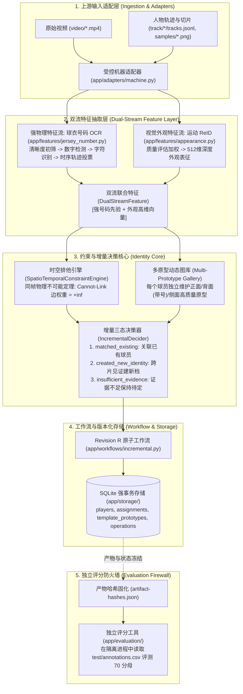

# 系统总体架构设计 (System Architecture)

本项目是专为**篮球比赛多片段、分批次输入**场景设计的球员身份建库、增量更新与事件追踪系统。系统采用**分层解耦、契约先行、数据隔离**的现代化软件架构。

---

## 1. 架构拓扑全景图

---

## 2. 核心分层设计与职责

### 第一层：上游输入适配层 (`app/adapters/`)
- **定位**：严格规范输入白名单。
- **职责**：
  - 读取 `test/track/<clip_id>/` 下的逐帧轨迹框与时间戳（`tracks.jsonl`）。
  - 读取对应的原分辨率人物抠图（`samples/*.png`）。
  - **安全隔离屏障**：严格禁止以任何方式读取 `test/annotations.csv` 或 `test/target/`，从源头杜绝作弊。

### 第二层：双流特征抽取层 (`app/features/`)
针对篮球场景下“同队球衣全同色”的致命痛点，采用双流异构特征：
1. **球衣号码强证据流 (Jersey Number OCR Stream)**：
   - **Legibility Gating**：剔除背光、严重遮挡或身体背对镜头看不到球衣正反面的低质帧。
   - **Number Recognizer**：利用轻量场景文本模型识别胸前/后背的 1~2 位数字。
   - **Temporal Tracklet Voting**：单段轨迹内多帧结果投票，聚合出整条轨迹的置信号码（如 `predicted_number=27, conf=0.95`）。
2. **视觉外观特征流 (Visual Appearance Stream)**：
   - 提取全局与局部姿态感知的深度特征向量（512 维，L2 归一化）。
   - 保留身体比例、肤色、球鞋与姿态微特征。
3. **双流融合逻辑**：
   - **一票否决**：若两段轨迹均明确识别出不同号码（如 10 vs 27），两者距离直接置为 $+\infty$。
   - **一票通过（强先验）**：若号码完全相同且外观颜色空间高度相容，赋予极高匹配加权。
   - **退化降级**：若任意一方号码不可读（未见号码），平滑回退至外观特征比对。

### 第三层：时空硬约束与增量决策核心 (`app/identity/`)
1. **时空排他约束引擎 (Spatio-Temporal Constraint Engine)**：
   - **Cannot-Link 原则**：在同一视频源的同一帧（或极短时间窗口内空间分离）中，两个目标绝不可能为同一人。
   - 构筑排他图矩阵，在聚类和图库比对时作为硬性阻断，彻底消除同机位混人。
2. **多原型动态图库 (Multi-Prototype Gallery)**：
   - 绝不采用单中心均值（Mean Centroid）表示球员。
   - 每个球员档案保留最多 $K$ 个典型视角原型（如：正面特写、背面清晰带号、侧身运球）。
   - 新样本只有在不降低图库纯度且通过质量门控时，才被接纳为新原型。
3. **增量决策三态机**：
   - `matched_existing`：通过全部门槛、无时空冲突、且比次优候选有明显竞争边距（$\Delta \ge 0.04$）。
   - `created_new_identity`：无法匹配已有球员，但在未分配候选池中通过**带 Cannot-Link 互斥约束的最大相容团（Maximal Compatible Clique）启发式挖掘**成团，且跨至少 2 个片段获得独立见证（`len(videos) >= 2`），且与现有所有人充分分离。
   - `insufficient_evidence`：单次孤立出现、距离模糊、存在歧义或无法满足跨 2 个独立片段见证的段，一律标记为待定（`unassigned`），存入延期提案池，**绝不贸然新建碎片档案，且避免连通分支级联误杀**。

### 第四层：工作流与版本化存储 (`app/workflows/`, `app/storage/`)
- **Revision R 原子递增机制**：每次分批输入作为一个独立批次，匹配和规划完全基于静态快照（Revision $R$），执行完成后原子递增至 $R+1$。
- **留一法重估 (Leave-one-out Reassessment)**：对于机器暂定归属（`proposed/automatic`），在新批次到达后，从图库中排除该段自身样本，重新复核其归属，发现更好匹配时支持版本化重分配，防止早期误判固化。
- **幂等性与中断恢复**：支持全链路中断续跑与重复重放，保障数据库状态一致。

### 第五层：独立评分防火墙 (`app/evaluation/`)
- 评分模块与推理代码物理隔离。
- 只有在推理完成、数据库提交并生成哈希校验码（`artifact-hashes.json`）后，评测进程才启动并读取标准答案进行客观比对。

### 第六层：无监督变点切分与规范收敛重算引擎 (`app/features/split.py`, `app/identity/matching.py`)
针对篮球视频长轨迹混人与分批到达时序敏感性两大核心挑战，架构在阶段二和阶段三引入了两大高精度防御机制：
1. **无监督色差与外观双变点切分器 (`app/features/split.py`)**：
   - 针对上游检测与跟踪算法中的 ID Switch（如 Clip 68 中 Track 8 在中途混入黄衣对手球员），结合跨全局窗口 HSV 饱合度阶跃差（$\Delta S_{\text{win}} \ge 50.0$）与局部 2 帧小窗阶跃差（$\Delta S_{\text{loc}} \ge 65.0$），配合步进余弦跳变（$d_{\text{step}} \ge 0.25$）与跨窗裕度（$\text{Margin} \ge 0.15$），在全场 0 虚警的前提下精准切断异人长轨迹，并在突变点前后插入安全待定缓冲期（Pending Safety Buffer），彻底剥离毒性污染原型，解除伪 Cannot-Link 阻塞。
2. **确定性规范收敛引擎 (`recompute_canonical` & `reconcile_canonical_revision`)**：
   - 针对视频分批到达次序引起的局部极值漂移，构建全局自然时空序视图 `(numeric_clip_id, start_frame, local_track_id, segment_id)`；
   - 在图库冻结前调用 `reconcile_canonical_revision` 执行全局规范重算与身份投影重排，实现数学意义上的全局同构（100 组伪随机排列压力测试 Exact Partition Match 达 100.0%，成对 Jaccard 与 NMI 方差 $\sigma^2 = 0$）。

