# 通用比赛内球员身份与事件管理模块架构设计

## 1. 范围、定位与交付状态

本项目是通用的比赛内球员档案建立、开放集合增量身份更新、多原型图库维护、事件关联与查询模块。设计面向变长比赛片段、未知球员人数以及无标注全自动机器输入的真实赛场场景。

### 核心定位与原则
1. **真实数据零标注冷启动与增量发现**：核心目标是在没有人工身份答案（零种子）、不依赖人工预先划定目标范围的前提下，自动从机器提取的视频轨迹、特征与逐帧观测中发现持久球员身份，并保持跨视频关联。
2. **预测推理与独立评分绝对隔离**：核心算法与推理工作流严禁读取真值文件（如 `annotations.csv`、`test/target/` 真实标签）；评分层通过哈希冻结断言（`assert_frozen_before_scoring`）和防泄漏哨兵（`assert_inference_isolation`）实现与预测层的物理防火墙隔离。
3. **分母严格固定与七级覆盖漏斗**：全仓统一使用全场 10 个比赛片段机器输入的不可变原子事实（158 条原始轨迹、1,759 个特征样本、75,465 条逐帧观测、1,346.35 秒时长）作为评估分母，彻底废除浮动分母，通过 7 级覆盖漏斗如实反映算法各关卡的信息保留。

### 全阶段最终交付状态（2026-11-12 终验结项）
7 阶段身份修复计划（阶段 0 至阶段 6）及工程微调已全案高质量闭环交付：
- **阶段 0**（统一覆盖漏斗与评测工具修复）：纠正浮动分母与 NaN 掩盖；确立 158 轨迹 / 1,759 样本 / 75,465 观测 / 1,346.35s 全场固定分母基准；修复时间严格半开区间与 F1 边界。
- **阶段 1**（空间绑定距离校准与离散度诊断）：实现 `DistanceCalibrationProfile` 契约（schema: `distance-calibration-profile-v1`）；实证诊断余弦距离集中与正负例重叠区间，确立近距阈值 near=0.18 与强反证一票否决阈值 far=0.45。
- **阶段 2**（轨迹内局部视角一致性 v3 与增量资格解耦）：实现第三代局部连续外观支持窗与过渡区检测；解耦建档资格与匹配资格；修复漏斗第 4 级与短段匹配门槛；闭环 R1~R4 四项漏洞（空间档案断言、准入过滤、增量单调性、部分复制防御）。
- **阶段 3**（多原型身份表示与模板证据结构）：废除单均值模糊表示，引入 `AppearancePrototype` 局部 medoid 多原型表示体系与相容视角匹配；增设迁移 `009_multi_prototype_templates.sql` 关系表；历史首次实现全场冷启动跨片段正向召回且精度达 100%（TP=83, FP=0）。
- **阶段 4**（候选生成与四道严苛集团验收解耦）：彻底解耦层次流形聚类候选生成与四道准入关卡（簇内强反证消除、Rival Margin 竞争边距、Tarjan 割边剪枝、跨至少 2 片段独立见证）；消除单桥接串联混人。
- **阶段 5**（统一冷启动与开放集合增量更新）：落实 Revision R 统一 7 步闭环更新流水线；消除“先遍历者先获利”时序漏洞；接入 `SpatioTemporalConstraintEngine` 时空物理硬互斥；输出三态互斥决策（`matched_existing`, `created_new_identity`, `insufficient_evidence`）；顺序稳定性 ARI 达到 0.9236。
- **工程微调**（27与15号球员工程微调）：闭环边缘特征对抗样本调优，保持全场零误合并与零拆分。
- **阶段 6**（角色边界解耦、复核契约完善与独立终验）：实现四层架构单向解耦；引入 `PersonRole` 枚举与匿名档案隔离（迁移 010 表达式索引）；建立绝对防火墙；升级 Review Queue 数据契约（提供时空坐标、视频 3 重叠框 critical 优先级与一键操作建议）；全场固定分母基准实测跨片对偶精度 100%（TP=68 Cold, TP=148 Forward, FP=0），跨球员误合并与拆分错误严格全部为 0，时空物理碰撞为 0，顺序稳定性 ARI 达到 0.9264 / 0.9823 / 0.8830；全部 740 项测试全数通过（739 passed, 1 skipped）。

---

## 2. 整体四层解耦架构

系统严格遵循单向依赖与关注点分离原则，划分为四个完全解耦的架构层次：

```mermaid
flowchart TD
    subgraph Layer1["1. 上游输入边界 (Adapters)"]
        direction TB
        M_IN["machine adapter (白名单只读读取)"]
        S_IN["sample_test adapter (历史样例回归)"]
        SO["source_observations (原始逐帧观测提取)"]
    end

    subgraph Layer2["2. 核心身份算法层 (Core Identity - 纯计算/无状态)"]
        direction TB
        PREP["prepare & track-consistency-v3 (局部支持窗/资格解耦)"]
        CALIB["calibration (空间绑定校准档案与四态语义)"]
        PROTO["representation (AppearancePrototype 多原型体系)"]
        STCE["constraints (SpatioTemporalConstraintEngine 时空硬互斥)"]
        CLUST["clustering (带约束层次流形聚类)"]
        DISC["discovery (四道严苛准入关卡 / Tarjan剪枝)"]
        INCR_ALG["incremental (Revision R 统一 7 步增量算法 / 三态判定)"]
        GUARD["evaluation/guard (防火墙防泄漏断言 / 哈希冻结)"]
    end

    subgraph Layer3["3. 业务编排与持久化 (Workflows & Storage)"]
        direction TB
        WF_INGEST["workflows.ingest (幂等校验与版本分流)"]
        WF_DISC["workflows.discover (空库冷启动发现)"]
        WF_INCR["workflows.incremental (开放集合增量分批推进)"]
        WF_REV["workflows.review (人工复核 / 角色设置 / 审计恢复)"]
        WF_READ["workflows.read (多角色分流查询 / 统计生成)"]
        SQLITE[("SQLite 存储引擎 (001~010 迁移 / 事务隔离)")]
        EV_ASSOC["events.associate (事件解耦延迟关联)"]
    end

    subgraph Layer4["4. 展示与独立评测 (Presentation & Evaluation)"]
        direction TB
        CLI["CLI baseline / validate"]
        VIEWS["PlayerView / PlayerStatsView / ReviewQueueItem"]
        BENCH["Stage6BenchmarkMetrics (9项显式终验指标)"]
        MANIFEST["EvaluationManifest (不可变固定分母基准清单)"]
    end

    Layer1 --> Layer3
    Layer3 --> Layer2
    Layer3 --> SQLITE
    Layer4 --> Layer3
    Layer4 -.->|"只读冻结产物"| GUARD
```

### 单向依赖铁律
1. **上游边界（Adapters）**：只将外部机器输入解析为标准的 `EvidenceBatch` 和内存特征字典，严禁反向感知业务工作流或数据库状态。
2. **核心算法层（Identity）**：所有核心算法均为无状态纯函数或纯领域模型，不读文件、不连数据库、不生成正式持久 `player_id`，绝不反向导入 `app.storage` 或 `app.workflows`。
3. **工作流层（Workflows）**：作为唯一的事务边界与编排者，负责在 SQLite 事务内加载快照、调用核心算法计算计划、校验业务外键与版本冲突，并原子提交。
4. **展示与评测层（Presentation & Evaluation）**：通过统一视图契约读取数据；评测子系统独立运行于产物冻结之后，不向推理过程反向注入参数。

---

## 3. 核心领域子系统设计

### 3.1 多原型身份表示体系 (`AppearancePrototype`)
彻底废弃单均值中心向量模糊表示，建立原始高质量样本与局部 medoid 相结合的多原型表示结构：
- **原型模型**：每个原型包含 `prototype_id`、`sample_id`、`time_bucket`、`feature`、`visibility`、`reliable_parts` 以及跨片段见证 `witness_sample_ids`。
- **相容视角查找**：两个段或球员之间的距离评估采用相容最佳视角匹配 $\min_{p \in P_A, q \in P_B} \text{dist}(p, q) \le \tau_{\text{near}}$，允许转身与机位变化。
- **少数反证一票否决**：若原型集合之间存在可比较且距离超过强反证阈值（$\text{dist}(p, q) \ge \tau_{\text{far}} = 0.45$）的高置信度视角对，直接触发一票否决，绝不用均值或多数票掩盖同身异人。
- **存储映射**：通过 `app/storage/migrations/009_multi_prototype_templates.sql` 引入 `template_prototypes` 关系表，实现多原型元数据、可靠部位与图库模板的严格关联与索引。

### 3.2 物理时空互斥约束网络 (`SpatioTemporalConstraintEngine`)
- **物理铁律**：同一摄像机位、同一比赛片段内，在同一时间半开区间 $[start\_s, end\_s)$ 存在空间分离框的多条轨迹，物理上绝对不可为同一个人（Must-Not-Link）。
- **穿透式硬拦截**：无论是流形聚类合并，还是增量匹配已有球员，任何导致同一簇/同一球员在同一时刻出现两个有效观测的操作，均被互斥引擎直接一票否决。
- **全场实证**：在全场 75,465 条逐帧观测上全量穿透硬断言排查，系统在冷启动、正序增量与逆序增量中，**时空物理碰撞数严格为 0**。

### 3.3 候选生成与四道严苛集团验收解耦 (`app/identity/discovery.py`)
将传统的“聚类即归组”拆解为两个独立阶段：
1. **候选聚类生成**：利用带排他约束的层次流形聚类，生成候选集团。
2. **四道严苛准入关卡（Group Admission Gates）**：
   - **关卡 1：簇内强反证消除**：簇内任意成员之间不得存在任何距离 $\ge 0.45$ 的反证对；
   - **关卡 2：Rival Margin 竞争对抗过滤**：组内最优支持度与组外竞争者距离差距必须 $\ge 0.04$，杜绝边界模糊的混人；
   - **关卡 3：Tarjan 割边剪枝**：计算支持图的双连通分量，剔除任何单桥接（Bridge）脆弱连接点，防止 A 似 B、B 似 C 导致的单连通混人；
   - **关卡 4：跨片段独立双见证校验**：集团必须跨越至少 2 个独立比赛片段，且至少存在 2 个独立的跨片原始见证样本。

### 3.4 统一冷启动与开放集合增量更新（Revision R 流水线）
消解冷启动与增量更新的双轨分歧，统一落实 Revision R 闭环 7 步流水线：
1. **批次摄入与轨迹分段**：接收新片段，执行 `track-consistency-v3` 生成一致性支持段；
2. **多原型图库比对**：与当前 Revision $R$ 的固定快照进行多原型相容匹配并计算 Rival Margin；
3. **时空互斥过滤**：调用 `SpatioTemporalConstraintEngine` 剔除存在同屏冲突的候选；
4. **未分配池与历史延期段联合建组**：将本批未分配段与数据库中的历史延期段（`segmentation_proposals`）合并，执行带排他约束的凝聚聚类与 Tarjan 割边剪枝；
5. **门槛分流**：已有匹配执行宽松门槛（$\tau=0.28$，支持 2 桶短段），新身份建档执行严格准入（全套四道关卡，$\ge 3$ 桶）；
6. **三态互斥判定**：
   - `matched_existing`：稳定关联已有持久 `player_id`；
   - `created_new_identity`：建立新的持久稳定匿名 `player_id`；
   - `insufficient_evidence`：单次出现或证据不完整段保持待定，写入延期提案；
7. **原子事务提交**：写入新球员、归属、多原型模板（009），推进版本至 Revision $R+1$。

### 3.5 角色边界解耦与展示分流
- **角色域定义**：`PersonRole` 枚举支持 `PLAYER`（正式球员）、`REFEREE`（裁判）、`STAFF`（工作人员）、`UNKNOWN_ROLE`（未确认角色，默认值）。
- **匿名身份档案隔离**：未人工确认角色的聚类实体作为 `anonymous_identity_profile` 保留轨迹、外观与时间线，但不进入正式球员统计（`PlayerStatsView`）与个人事件排行榜，杜绝裁判/工作人员污染数据。
- **运营一键角色赋权**：支持通过 `SetPlayerRoleCommand` 独立设置角色，轻量推进 revision 而无需破坏性重构图库。
- **数据库索引兼容**：通过 `010_player_role.sql` 创建 `idx_players_role ON players(match_id, json_extract(json, '$.role'))` 表达式索引，保持旧表物理 4 列结构完全不变。

### 3.6 预测层与评分层绝对隔离防火墙 (`app/evaluation/guard.py`)
- **防泄漏哨兵**（`assert_no_ground_truth_in_evidence`）：在 `EvidenceBatch` 摄入时严密扫描来源路径，发现包含 `annotations.csv`、`target`、`ground_truth` 等关键字立即抛出 `GroundTruthLeakageError` 并熔断。
- **调用栈隔离**（`assert_inference_isolation`）：断言推理函数绝不被评测打分函数递归调用。
- **产物哈希冻结断言**（`assert_frozen_before_scoring`）：评分程序启动前必须完整读取 `artifact-hashes.json`，核验包括 `predictions.json`、`summary.json`、`player-library.sqlite3` 在内的所有产物 SHA-256 哈希，完全匹配才允许打开真值文件。

---

## 4. 存储架构与增量迁移体系

SQLite 作为系统的持久状态源，存储层集中在 `player-library.sqlite3`，严格按 `match_id` 实施比赛级逻辑隔离。数据库模式通过严格版本化的迁移脚本演进：

| 迁移版本 | 核心文件 | 职责与架构特性 |
| :--- | :--- | :--- |
| **001** | `001_initial.sql` | 基础表：matches, clips, tracks, segments, samples, players, assignments, templates, events 等 |
| **002** | `002_workflows.sql` | 记录业务工作流执行日志与元数据 |
| **003** | `003_workflow_plans.sql` | 暂存算法生成的候选变更计划 |
| **004** | `004_revision_states.sql` | 业务修订状态清单，支持不可变版本追加与可追溯历史恢复 |
| **005** | `005_clean_review_binding.sql` | 清洁审核与样本来源版本显式绑定 |
| **006** | `006_track_observations.sql` | 存储原生逐帧机器观测框与时间点，支撑时空物理互斥 |
| **007** | `007_identity_discovery.sql` | 保存不可变自动发现报告与组到持久球员映射 |
| **008** | `008_segmentation_proposals.sql` | 机器分段提案与资格（`supported`/`unknown`）持久化，消除跨批次重复计算 |
| **009** | `009_multi_prototype_templates.sql` | 多原型模板关系表 `template_prototypes`，支持局部 medoid、时间桶与可靠部位 |
| **010** | `010_player_role.sql` | 角色表达式索引 `idx_players_role`，实现正式球员与匿名档案的零侵入物理分流 |

---

## 5. 事务并发与一致性模型

1. **事务边界集中于 Workflows**：Storage 仓储层辅助函数严禁自行调用 `commit` 或 `rollback`，所有写操作必须由工作流用例的 `with transaction(connection):` 显式包裹。
2. **悲观排他锁**：写事务使用 `BEGIN IMMEDIATE`，确保在开始时刻即获取 SQLite 写入锁，避免死锁。
3. **乐观并发版本控制**：调用 `advance_revision(match_id, expected_revision, ...)` 校验期望版本。若并发修改导致实际版本不符，抛出 `RevisionConflict` 并触发整个事务原子回滚，重读快照后重新计划。
4. **图库快照隔离**：算法计算全过程使用批次启动时读取的不可变 `GallerySnapshot`，当前批次内的写计划在事务成功提交前对外部完全不可见，杜绝批内错误级联。

---

## 6. 全场基准终验结果与工程指标

基于全场 10 个比赛片段机器输入（158 原始轨迹、1,759 特征样本、75,465 逐帧观测、1,346.35 秒时长）的阶段 6 独立终验实测成绩：

| 评估维度 (Metric Dimension) | Cold (全量冷启动) | Forward (正序增量 4 批次) | Reverse (逆序增量 4 批次) | 物理与业务标准 |
| :--- | :---: | :---: | :---: | :--- |
| **跨片段对偶精度 (Precision)** | **1.0000 (100.0%)** | **1.0000 (100.0%)** | NaN (零正类时不假报) | 严格无误报 (FP=0, TP=68 Cold, 148 Fwd) |
| **混人率 (Merge Error Rate)** | **0.0% (0/7)** | **0.0% (0/5)** | **0.0% (0/5)** | 绝对无不同真值混入同一档案 |
| **同人拆档率 (Split Error Rate)**| **0.0% (0 处)** | **0.0% (0 处)** | **0.0% (0 处)** | 目标真值人物无一人被拆分多档 |
| **已归人纯度 (Assigned Purity)**| **1.0000 (100.0%)** | **1.0000 (100.0%)** | **1.0000 (100.0%)** | 多数类真值占据 100% 比例 |
| **时空物理违规 (Collisions)** | **0 violations** | **0 violations** | **0 violations** | 全场 75,465 条逐帧观测零同屏碰撞 |
| **联合归属稳定性 (Joint ARI)**| Cold vs Fwd: **0.9264** | Cold vs Rev: **0.9823** | Fwd vs Rev: **0.8830** | 极高拓扑顺序稳定性，一致率 >99.67% |
| **非球员污染率 (Pollution)** | **0.0%** | **0.0%** | **0.0%** | 匿名档案默认隔离，未污染正式统计 |
| **单元测试通过率** | **100% (739 passed, 1 skipped)** | 全部业务与契约测试全数通过 |
