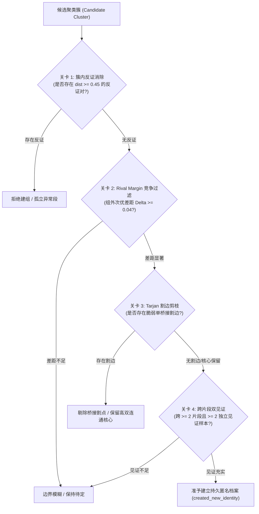

# 身份策略与决策规范 (Identity Policy Specification)

本文档固定比赛内球员身份核心算法、图库维护、准入门槛与增量决策的权威策略规范，杜绝各入口随意自定算法逻辑。

---

## 1. 核心设计原则

1. **零人工先验与真实赛场泛化**：算法不预设比赛总人数、队伍颜色、球衣号码先验，也不以固定聚类簇数 $K$ 作为终止条件。
2. **多原型相容与少数异类一票否决**：人体运动（转身、跑动）产生多视角外观流形。算法通过多原型表示（`AppearancePrototype`）允许视角相容切换；同时对出现明确相斥外观（$\text{dist} \ge 0.45$）的强反证执行一票否决，绝不用均值模糊或多数票掩盖同身异人。
3. **物理时空硬互斥底线**：同一摄像机位、同一比赛片段在同一时刻出现的不同检测框，物理上绝对不可为同一个人。时空硬互斥网络（`SpatioTemporalConstraintEngine`）具有超越任何特征相似度的最高拦截权。
4. **准入与生成彻底解耦**：层次聚类仅用于生成候选联通集团，集团必须经受“簇内反证消除、竞争对抗差、Tarjan 割边剪枝、跨片段双见证”四道严苛集团验收关卡，杜绝脆弱桥接导致的单链混人。
5. **已有匹配与新建建档门槛分流**：已有球员匹配执行稳健收敛门槛；新建身份执行高准入门槛；证据不足者一律保持待定（`insufficient_evidence`），记录延期提案，绝不因距离远或无匹配而擅自建立新人。

---

## 2. 特征表征与空间度量策略

### 2.1 多原型体系与相容匹配策略
- **局部 Medoid 提炼**：按 0.5 秒时间桶对一致性身份段内的样本进行聚合，剔除遮挡与不可比样本，在各时间桶内选择与其它样本均值最近的高质量样本作为局部原型（Medoid）。
- **可靠部位加权池化**：针对 ReID 提取的 6 个解剖学身体部位，仅纳入可见度 $v_i \ge 0.2$ 的可靠部位。特征融合采用平方根可见度加权均值并执行 $L_2$ 归一化。
- **视角相容距离度量**：查询段 $A$（原型集 $P_A$）与候选目标 $B$（原型集 $P_B$）之间的有效外观距离定义为相容视角的最近邻距离：
  $$\text{dist}(A, B) = \min_{p \in P_A, q \in P_B} \text{KPR\_dist}(p, q)$$
  其中 $\text{KPR\_dist}$ 仅计算双方共同可靠部位（至少 2 个），除以部位权重之和并映射到 $[0.0, 1.0]$。
- **少数反证一票否决（One-Vote Veto）**：
  若在两组原型的所有可比配对中，存在高置信度视角对满足：
  $$\exists (p \in P_A, q \in P_B), \quad \text{KPR\_dist}(p, q) \ge \tau_{\text{far}} = 0.45$$
  则该段对被直接判定为强相斥关系，正向匹配或合并操作立即终止。

---

## 3. 时空物理互斥策略 (`SpatioTemporalConstraintEngine`)

1. **Must-Not-Link 铁律**：
   对于同片段内的任意两条轨迹/身份段 $s_1, s_2$：
   $$\text{overlap}(s_1, s_2) = \max(s_1.\text{start\_s}, s_2.\text{start\_s}) < \min(s_1.\text{end\_s}, s_2.\text{end\_s})$$
   若存在逐帧观测证明二者具有空间分离框（非重复框），则在时空约束图中确立永久 `Must-Not-Link` 边。
2. **聚类与匹配硬过滤**：
   - 聚类合并时，若拟合并的两个簇之间存在任何一条 `Must-Not-Link` 边，合并被绝对禁止；
   - 增量匹配时，若待分配段与候选球员名下已有轨迹存在同屏时间重叠，该候选球员直接从匹配列表中移除。
3. **零碰撞指标标准**：
   系统在全场 75,465 条逐帧观测上的穿透排查中，时空碰撞违规数必须严格为 0。

---

## 4. 集团验收与四道准入关卡策略 (`app/identity/discovery.py`)

层次凝聚聚类输出候选簇后，候选簇必须完整通过四道严苛关卡方可转为正式球员建档：

1. **关卡 1：簇内强反证消除**：候选簇内任意两个成员段之间，不得存在任何距离 $\ge 0.45$ 的反证对。
2. **关卡 2：Rival Margin 竞争对抗过滤**：候选簇成员与簇外最佳竞争者的平均外观距离，必须比组内平均距离大至少 $\Delta \ge 0.04$。若存在组外强对抗者且边距不足，成员被安全排除。
3. **关卡 3：Tarjan 割边剪枝**：将候选簇构建为支持图，运行 Tarjan 割点/割边算法。任何移除后会导致图连通分支增加的“单桥接”（Bridge）节点被视为脆弱串联点予以剪除，杜绝 A 似 B、B 似 C 但 A 与 C 毫无渊源的串联混人。
4. **关卡 4：跨片段独立双见证校验**：集团必须跨越至少 2 个独立片段，且图库模板必须从至少 2 个不同片段的独立见证样本中选出。

---

## 5. 统一增量更新与三态决策策略 (`app/identity/incremental.py`)

开放集合分批到达时，系统统一执行 Revision R 闭环更新，输出三态互斥决策：

### 5.1 门槛分流策略
- **已有球员匹配门槛（Match Threshold）**：
  $\tau_{\text{existing}} = 0.28$。放宽允许具备 2 个时间桶的短段（`can_match_existing=True`）在满足 `min_match_buckets=2` 与时空无冲突时匹配已有球员。
- **新建身份建档门槛（New Identity Threshold）**：
  严格执行四道集团验收关卡，且要求至少 3 个独立时间桶、覆盖至少 2 个片段，且 `can_create_new_identity=True`。短段严禁独立建档。

### 5.2 三态决策互斥语义
1. **`matched_existing` (匹配已有球员)**：
   - 查询段与图库某活跃模板相容距离 $\le 0.28$；
   - 相对次优候选球员保持至少 $0.04$ 的 Rival Margin；
   - 与该候选球员当前持有的全部轨迹无时空物理碰撞；
   - 决策：提议赋予已有 `player_id`，不增加球员档案，杜绝旧人重复建档。
2. **`created_new_identity` (新建持久身份)**：
   - 未分配段与历史延期段在未分配池中完成层次流形聚类；
   - 完整通过四道严苛准入关卡；
   - 与所有已有图库球员保持充分分离；
   - 决策：建立新的持久稳定匿名 `player_id`，生成首期图库多原型模板。
3. **`insufficient_evidence` (证据不足保持待定)**：
   - 单次出现、视角单一、与已有球员边界模糊、或见证不足的段；
   - 决策：保持待定（`status="unassigned"`），写入 `segmentation_proposals` 作为延期提案，等待后续批次补充跨视角证据。**无匹配或距离远绝不单独作为建立新人的证据**。

---

## 6. 角色边界与呈现策略

1. **角色域与默认隔离**：
   - 系统支持 `PLAYER`、`REFEREE`、`STAFF`、`UNKNOWN_ROLE`；
   - 算法自动发现的实体默认赋予 `UNKNOWN_ROLE`（匿名身份档案）；
   - 呈现层仅对 `role == PersonRole.PLAYER` 的档案开放正式比赛统计（`PlayerStatsView`）与个人事件榜单，裁判与工作人员默认被完全隔离。
2. **人工赋权与轻量修订**：
   - 运营人员核实匿名档案后，通过 `SetPlayerRoleCommand` 将其确认为正式球员；
   - 角色修改利用 SQLite 迁移 010 表达式索引加速生效，不破坏性改写图库或归属。

---

## 7. 防火墙隔离与评测策略

1. **推理防泄漏**：推理算法全链路严禁接收人工标注文件（`annotations.csv`、`test/target/` 真实标签）。
2. **哈希冻结门限**：独立评分前强制验证所有冻结产物的 SHA-256（`assert_frozen_before_scoring`）。
3. **无正类报 NaN 原则**：当评测范围内没有正类对偶时，跨片段对偶精度必须严格返回 `NaN`，杜绝使用虚假的 100% 欺骗系统。
