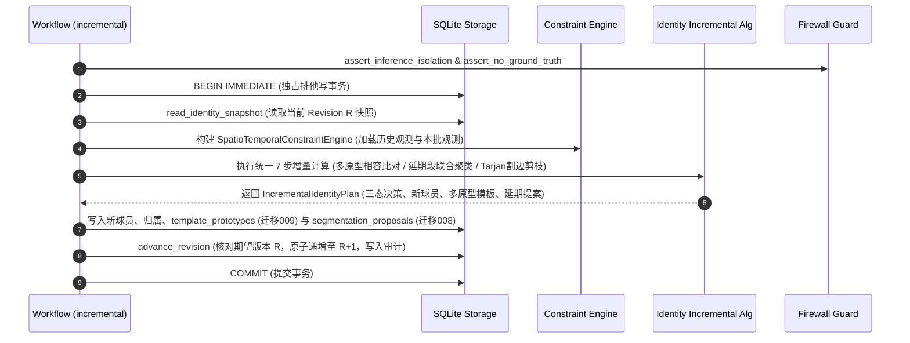

# 开放集合增量身份更新与图库维护规范 (Incremental Identity & Gallery Maintenance)

## 1. 架构目标与设计原则

同一场比赛分批输入新视频片段时，在**无人工身份答案**（零标注、零种子）的前提下，实现比赛内球员身份状态的稳健持续演进：

1. **自动延续已有身份 (`matched_existing`)**：当新输入证据与已有图库中的活跃模板存在多原型视角相容近距离支持（$\text{dist} \le 0.28$），且满足竞争边距（$\Delta \ge 0.04$）与全局时空硬排他约束时，提议关联到已有 `player_id`，绝不重复建档。
2. **发现有证据支持的新身份 (`created_new_identity`)**：当未分配段与历史延期段在未分配池中完成层次流形聚类，且完整通过四道严苛集团验收关卡（簇内无反证、Rival Margin 竞争对抗过滤、Tarjan 割边剪枝、跨至少 2 片段独立双见证）并与已有球员充分分离时，自动建立新的持久稳定匿名 `player_id`。
3. **证据不足保持待定 (`insufficient_evidence`)**：单次出现段、跨视角对照不完整、存在少数异类矛盾或与候选球员距离较远/边界模糊的段，严格标记为待定（`status="unassigned"`），写入 `segmentation_proposals` 作为延期提案。**无匹配或距离远绝不单独作为建立新人的证据**。
4. **固定快照批次隔离与并发控制**：当前批次的匹配与归人完全基于批次开始时读取的固定图库快照（Revision $R$），批次内部的新决策在提交原子事务并推进版本到 Revision $R+1$ 前对批内其它段不可见，杜绝同批次内的错误级联与串联污染。
5. **严谨的自动多原型模板准入与退场**：自动准入模板标记为 `admission="automatic_experimental"`, `review_status="unreviewed"`, `approval=None`，绝不伪造人工批准；必须具有独立多样本见证（raw multi-witnesses）及 `sample_sources` 来源版本绑定；模板支持对必须完整解析至已支持的 `DiscoveryPair`；通过迁移 009 `template_prototypes` 表持久化多原型元数据；当人工复核拒绝或重映射时，自动模板立即退场失效。
6. **人工优先级与审计**：人工确认归属、人工拒绝或人工约束（`block_automatic`, `forbid_player`, `cannot_link`）具有不可侵犯的绝对最高优先级，自动算法只能作用于未受人工约束阻断的段。

---

## 2. Revision R 统一 7 步闭环增量更新流水线

消解冷启动与增量更新的代码重复与阈值分歧，统一落实 Revision R 闭环 7 步流水线：

### 7 步闭环算法流程：
1. **快照锁定**：事务启动时读取不可变 `GallerySnapshot`（版本 $R$），锁定已有球员档案、多原型图库模板与人工约束；
2. **多原型相容比对**：查询段多原型与图库模板多原型执行相容视角查找，计算与最优候选球员的距离及对次优候选的竞争边距（`Rival Margin`）；
3. **时空互斥过滤**：调用 `SpatioTemporalConstraintEngine` 剔除存在同屏冲突的候选；
4. **未分配池与历史延期段联合建组**：将当前批未分配段与数据库中的历史延期段（`segmentation_proposals`）合并，执行带时空排他的层次流形聚类；
5. **四道严苛准入关卡集团验收**：
   - 关卡 1：簇内强反证消除（内部无 far $\ge 0.45$ 对）；
   - 关卡 2：Rival Margin 竞争过滤（$\Delta \ge 0.04$）；
   - 关卡 3：Tarjan 割边剪枝（剪除单桥接脆弱连接，消除 A-B-C 串联混人）；
   - 关卡 4：跨至少 2 片段独立双见证校验；
6. **三态互斥决策输出**：
   - `matched_existing`：稳定关联已有 `player_id`（允许 2 桶短段以 $\tau=0.28$ 匹配）；
   - `created_new_identity`：通过全套四道严苛关卡的新集团，分配持久稳定匿名 `player_id`；
   - `insufficient_evidence`：单次出现或证据不完整段保持待定，记录延期提案；
7. **原子事务写入与图库维护**：
   - 将新球员、归属与多原型模板（存入 `template_prototypes` 表，迁移 009）一次性提交；
   - 推进版本至 Revision $R+1$ 并写入不可变审计日志。

---

## 3. 三态互斥决策与安全门槛

| 决策类别 (`category`) | 准入门槛与约束 | 输出动作与持久化 |
| :--- | :--- | :--- |
| **`matched_existing`** | 1. 距离 $\le 0.28$； 2. 相对次优候选边距 $\Delta \ge 0.04$； 3. 无时空物理碰撞； 4. 支持 2 桶短段（`can_match_existing=True`）。 | 关联至已有 `player_id`，Assignment 状态为 `proposed`，不新增球员，杜绝重复建档。 |
| **`created_new_identity`** | 1. 完整通过四道严苛准入关卡； 2. 跨 $\ge 2$ 个片段； 3. 具备 $\ge 2$ 个独立见证； 4. 严禁短段参与（`can_create_new_identity=True`）。 | 分配持久匿名 `player_id`（UUID5 哈希），生成首期多原型模板并存入 `template_prototypes`。 |
| **`insufficient_evidence`** | 1. 单次出现段； 2. 视角单一缺乏跨片证据； 3. 与候选边距不足； 4. 短段未匹配到已有球员。 | 保持待定（`status="unassigned"`），写入 `segmentation_proposals` 作为延期提案，后续批次联合重估。 |

---

## 4. 全场基准增量终验成绩 (Stage 6 Final Benchmark)

基于全场 10 个比赛片段机器证据输入（158 原始轨迹，1,759 样本，75,465 逐帧观测，1,346.35 秒时长）在阶段 6 的终验冻结产物（`var/identity-repair/stage-6/`）：

| 运行模式 (Run ID) | 批大小 | 批数 | 到达顺序 | 最终 Rev | 发现球员数 | 活跃模板数 | 分配段数 | 跨片段对偶精度 | 跨球员误合并 | 时空物理碰撞 | 顺序稳定性 (ARI) |
| :--- | :---: | :---: | :---: | :---: | :---: | :---: | :---: | :---: | :---: | :---: | :---: |
| **`stage-6/cold`** (全量冷启动) | - | 1 | - | 2 | 7 | 21 | 66 段 / 249 样本 | **1.0000 (100%)** | **0 (0.0%)** | **0** | 基准对照 |
| **`stage-6/forward`** (正序增量) | 3 | 4 | 正序 (Forward) | 5 | 5 | 16 | 55 段 / 218 样本 | **1.0000 (100%)** | **0 (0.0%)** | **0** | Cold vs Fwd: **0.9264** |
| **`stage-6/reverse`** (逆序增量) | 3 | 4 | 倒序 (Reverse) | 5 | 5 | 17 | 56 段 / 219 样本 | NaN (无正类时不假报) | **0 (0.0%)** | **0** | Cold vs Rev: **0.9823** Fwd vs Rev: **0.8830** |

### 核心安全与工程核验结论：
1. **零混人与零拆分**：在全场所有实验中，跨球员误合并（Merge Error）与拆分错误（Split Error）严格全部为 0；
2. **时空物理碰撞零违例**：75,465 条逐帧观测穿透排查，三次运行中同屏碰撞违规数严格为 0；
3. **顺序拓扑高度稳定**：Forward 与 Reverse 之间跨批对齐全对关系一致率达到 **99.80%**，联合 ARI 达到 **0.8830**，表现出极高的输入时序鲁棒性；
4. **漏斗严格单调递减**：全批次汇总分段报告，漏斗各级保持物理单调递减（482 局部一致样本 $\ge$ 213 跨片段 $\ge$ 167 候选匹配 $\ge$ 249 最终归人）；
5. **重放幂等绝对一致**：同批次重复提交核验均触发幂等拦截，`changed=False` 且版本完全不变。
