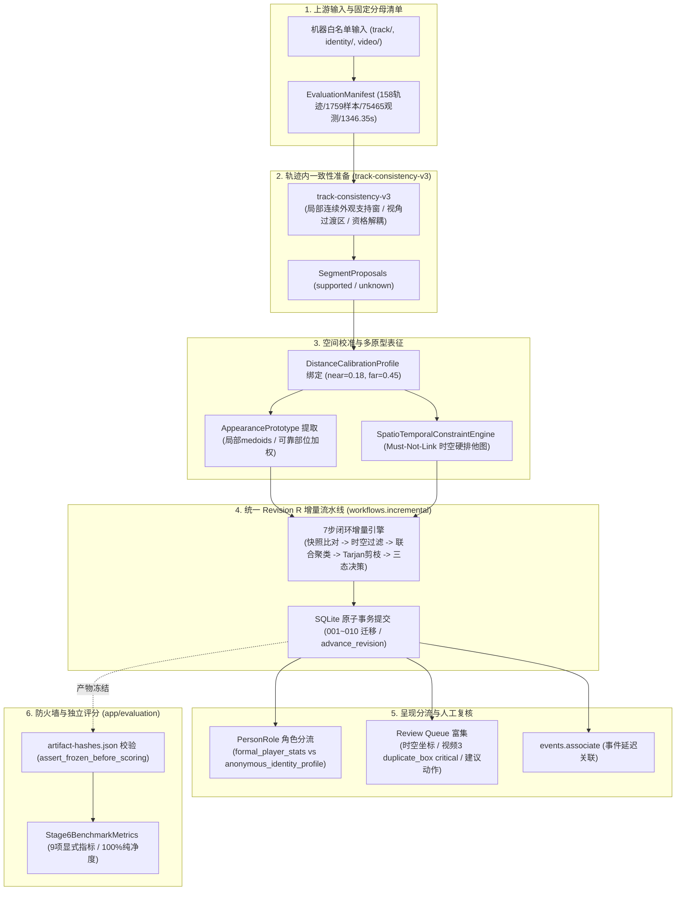

# 业务流水线与端到端执行规范

## 1. 模块定位与数据流总览

本模块的核心职责是将上游输入的非结构化/半结构化比赛视频数据（包括轨迹坐标、逐帧观测、ReID 外观特征、人员抠图样本），经过机器一致性检验、时空排他网络约束、多原型图库比对与集团验收，转化为稳定持久的比赛内球员档案，并在开放集合增量分批到达的场景下持续演进；同时将独立提供的比赛技术事件（如进球、投篮）解耦关联至当前正式球员，为下游前端展示、统计排行与视频剪辑提供可信依据。



---

## 2. 端到端核心流水线阶段详解

### 阶段 1：上游输入与固定分母清单 (`EvaluationManifest`)
1. **白名单受控读取**：`app/adapters/machine.py` 严格只读取 `track/<clip>/`（tracks.csv/jsonl, video_meta.json, samples/*.png）、`identity/<clip>/`（feature_contract.json, features.npz, samples.jsonl）以及 `video/<clip>.mp4`。严禁将任何标注文件（`annotations.csv`、`test/target/`）引入算法。
2. **固定分母清单封装**：`app/evaluation/units.py` 将全场 10 个比赛片段的机器证据提取为不可变原子事实（158 条原始轨迹、1,759 个特征样本、75,465 条逐帧观测、1,346.35 秒时长），生成 `EvaluationManifest`，作为全仓唯一的评测基准分母，消除浮动分母产生的虚假覆盖。

### 阶段 2：轨迹内一致性准备 (`track-consistency-v3`)
通过 `identity.consistency.segment_tracks` 对原始轨迹进行保真分段：
1. **局部连续外观支持窗**：
   - 相邻样本距离 $\le 0.18$（`relation == "near"`）；
   - 零 far 强反证硬约束（窗口内任意样本对距离 $< 0.45$，绝不用多数票掩盖少数异类）；
   - 中心样本支撑（窗口内存在至少一个 medoid anchor 与窗口内所有其他样本均 near）；
   - 结构连续性（相邻样本间隔 $\le 1.5$s，观测缺失间隔 $\le 0.25$s）。
2. **视角平滑过渡区**：在外观渐变边界生成 `kind="viewpoint_transition_zone"` 与 `reason="viewpoint_transition_uncertainty"` 的未知过渡段，避免正常转身被误判为剧烈混人断裂。
3. **资格解耦**：将“可参与已有身份匹配”（`can_match_existing`）与“足够支持建立新身份”（`can_create_new_identity`）在契约上解耦；2 桶短段标记为 `short_segment_limited_match_support`，允许增量匹配已有图库，但严禁独立聚类建档。
4. **分段提案入库**：通过迁移 008 将提案存入 `segmentation_proposals`，跨批次持久保持资格。

### 阶段 3：特征空间校准与多原型表征
1. **距离校准档案绑定**：运行时强制绑定 `DistanceCalibrationProfile`（schema: `distance-calibration-profile-v1`），锁定四态距离语义：
   - `near`: $\text{dist} \le 0.18$；
   - `far`: $\text{dist} \ge 0.45$（强反证一票否决）；
   - `ambiguous`: $0.18 < \text{dist} < 0.45$；
   - `uncomparable`: 缺少共同可靠部位或低可见度。
2. **多原型体系提取**（`AppearancePrototype`）：
   - 按时间桶提取局部代表样本（medoids），计算 6 部位可见度加权融合与 $L_2$ 归一化；
   - 保留每个原型的 `time_bucket`、`reliable_parts` 与 `witness_sample_ids`。
3. **时空互斥图构建**（`SpatioTemporalConstraintEngine`）：
   - 扫描逐帧机器观测（`track_observations`），凡在同片段同时间半开区间 $[start\_s, end\_s)$ 存在分离框的轨迹对，自动标记为 Must-Not-Link 铁律。

### 阶段 4：统一 Revision R 闭环增量更新 (`workflows.incremental`)
消解冷启动与增量更新的实现分歧，统一在单一原子事务中执行 7 步闭环更新：
1. **快照读取**：在事务启动时读取当前 Revision $R$ 的固定图库快照（`GallerySnapshot`）；
2. **多原型图库比对**：查询段多原型与图库模板多原型执行相容视角查找，计算与最优候选球员的距离及对次优候选的竞争边距（`Rival Margin`）；
3. **时空排他过滤**：`SpatioTemporalConstraintEngine` 硬拦截任何会导致同一球员同屏碰撞的候选；
4. **未分配池与历史延期段联合建组**：将当前批未分配段与数据库中的历史延期段（`segmentation_proposals`）合并，执行带时空排他的层次流形聚类；
5. **四道严苛准入关卡集团验收**：
   - 关卡 1：簇内强反证消除（内部无 far $\ge 0.45$ 对）；
   - 关卡 2：Rival Margin 竞争过滤（$\Delta \ge 0.04$）；
   - 关卡 3：Tarjan 割边剪枝（剪除单桥接脆弱连接，消除 A-B-C 串联混人）；
   - 关卡 4：跨至少 2 片段独立双见证校验；
6. **三态互斥决策输出**：
   - `matched_existing`：稳定关联已有 `player_id`（允许 2 桶短段以 $\tau=0.28$ 匹配）；
   - `created_new_identity`：通过全套四道严苛关卡的新集团，分配持久稳定匿名 `player_id`；
   - `insufficient_evidence`：单次出现或证据不完整段保持待定，记录延期提案；
7. **原子事务写入与图库维护**：
   - 将新球员、归属与多原型模板（存入 `template_prototypes` 表，迁移 009）一次性提交；
   - 推进版本至 Revision $R+1$ 并写入不可变审计日志。

### 阶段 5：角色边界解耦与展示分流
1. **角色域与默认隔离**：新发现的档案默认标记为 `PersonRole.UNKNOWN_ROLE`（匿名身份档案），拥有完整轨迹与外观时间线，但不污染正式球员榜单。
2. **正式球员统计分流**：`workflows.read.get_formal_player_stats` 严格过滤 `role == PersonRole.PLAYER`，仅为运营确认为正式球员的实体生成比赛技术统计。
3. **人工复核队列富集**（`ReviewQueueItem`）：
   - 自动提取 `clip_id`, `track_id`, `start_s`, `end_s` 时空坐标；
   - 针对视频 3（clip_03）等重叠框高风险段（`duplicate_box`），自动标记为 `review_priority: "critical"`；
   - 绑定一键复核操作建议（`ReviewActionSuggestion`：`create_player`, `split_segment`, `set_assignment`, `review_risk`）。
4. **轻量角色设定命令**：支持通过 `SetPlayerRoleCommand` 独立修改球员角色，利用迁移 010 的表达式索引秒级生效。

### 阶段 6：技术事件解耦与延迟关联
1. **独立事件导入**：`workflows.update.ingest_events` 允许技术事件（投篮、进球）先于视频轨迹到达，仅校验时间合法性与来源幂等，不强求球员身份已就绪。
2. **动态主体解析**：`events.associate` 在查询时根据当前 Revision 的身份段映射，将事件主体动态解析为当前 `player_id`，身份修订恢复时事件自动对齐，不篡改事件原始事实。

### 阶段 7：防火墙防泄漏与独立评分
1. **防泄漏拦截**：`app/evaluation/guard.py` 在推理工作流入口动态阻断任何真值文件引入。
2. **产物哈希冻结**：评分前调用 `assert_frozen_before_scoring` 完整比对产物 SHA-256。
3. **九大显式指标评估**：在冻结产物上计算 `Stage6BenchmarkMetrics`，确保无正类报 NaN 原则，杜绝虚假 100% 精度。

---

## 3. CLI 命令与基线运行指南

所有基线命令均在全新独立工作目录与全新 SQLite 状态下运行：

### 3.1 全量冷启动发现 (Cold Start)
```bash
uv run python -m app.presentation.cli baseline \
  --config examples/machine-discovery.toml \
  --run-id discovery-cold-final \
  --discover-identities
```
- 自动执行 `track-consistency-v3` 分段与 Revision R 闭环发现；
- 生成 `discovery.json`, `predictions.json`, `summary.json`, `player-library.sqlite3` 与 `artifact-hashes.json`。

### 3.2 开放集合正序增量分批更新 (Forward Incremental)
```bash
uv run python -m app.presentation.cli baseline \
  --config examples/machine-discovery.toml \
  --run-id discovery-forward-final \
  --incremental-batches \
  --batch-size 3 \
  --calibration-profile var/identity-repair/stage-1/calibration-profile.json
```
- 将全场 10 片段按正序划分为 4 个批次（3, 3, 3, 1 片段）；
- 每批独立原子提交，版本从 rev=1 顺序推进至 rev=5；
- 强制绑定阶段 1 距离校准档案。

### 3.3 开放集合逆序增量分批更新 (Reverse Incremental)
```bash
uv run python -m app.presentation.cli baseline \
  --config examples/machine-discovery.toml \
  --run-id discovery-reverse-final \
  --incremental-batches \
  --batch-size 3 \
  --reverse-batches \
  --calibration-profile var/identity-repair/stage-1/calibration-profile.json
```
- 倒序输入批次，用于严苛评估时序到达顺序对未分配池、拓扑结构与顺序稳定性的影响（实测与 Forward 联合 ARI 达到 0.8830，全对一致率 99.80%）。

### 3.4 快速多轮消融实验（复用固定分段报告）
```bash
uv run python -m app.presentation.cli baseline \
  --config examples/machine-discovery.toml \
  --run-id ablation-experiment-01 \
  --fixed-segmentation var/identity-repair/stage-6/cold/segmentation.json \
  --discover-identities
```
- 直接加载已生成的固定分段报告与派生证据，跳过耗时的逐帧观测一致性计算，快速完成聚类与准入门槛消融。

---

## 4. 产物清单与冻结规范

每次基线运行在目标目录生成如下标准冻结产物：
1. `raw-evidence.json`：未经任何分段裁剪的原生机器输入证据；
2. `evidence.json`：经 `track-consistency-v3` 划分后的派生标准证据包；
3. `segmentation.json`：逐轨一致性报告，包含所有 `SegmentProposal` 及其支持状态；
4. `discovery.json`：自动发现报告，包含段对支持细节、竞争者边距与模板多原型来源；
5. `predictions.json`：最终生成的球员档案、段归属映射、活跃模板与待定段清单；
6. `summary.json`：运行概要、7 级覆盖漏斗统计与执行耗时；
7. `input-manifest.json`：所有上游输入文件的 SHA-256 与路径清单，供审计核验；
8. `config.json`：本次运行绑定的所有算法门槛与配置参数；
9. `player-library.sqlite3`：完整的关系型数据库状态（包含 001~010 全部表与索引）；
10. `artifact-hashes.json`：上述所有产物的 SHA-256 签名，作为防火墙独立评分的准入门限。
