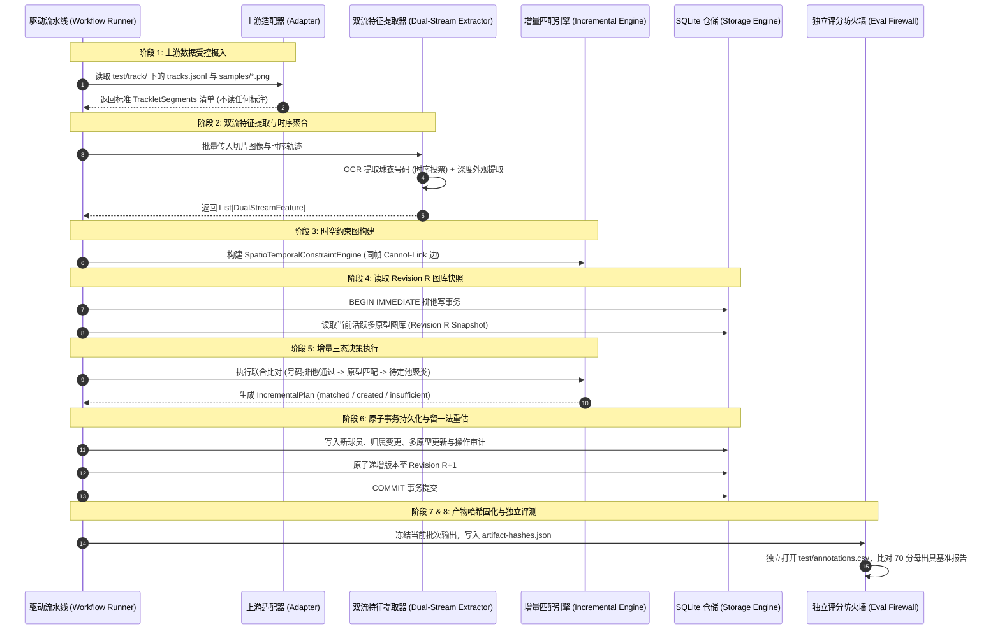

# 业务流水线与生命周期规范 (Pipeline Specification)

本文档规范 `player-library` 端到端处理数据流的 8 个闭环阶段，明确各阶段的输入输出契约与执行逻辑。

---

## 1. 端到端执行流水线全景

---

## 2. 流水线阶段详解

### 阶段 1：受控机器输入摄入 (`Ingestion`)
* **输入源**：
  * `test/track/<clip_id>/tracks.jsonl`：包含每一帧的检测框与置信度。
  * `test/track/<clip_id>/samples/*.png`：上游跟踪器导出的原尺寸高清人物抠图。
  * `test/track/<clip_id>/video_meta.json`：帧率、分辨率等机器元数据。
* **处理逻辑**：
  * 过滤帧数 $< 3$ 或曝光时长 $< 0.1s$ 的短碎片；
  * 构建标准内存对象 `TrackletSegment`。
* **铁律**：严禁打开任何 `annotations.csv`。

### 阶段 2：双流特征提取与时序投票 (`Dual-Stream Extraction`)
* **并行执行两路处理**：
  1. **OCR 号码流**：
     * 遍历轨迹内各帧切片，计算图像清晰度（Laplacian 方差与边缘清晰度）；
     * 筛选出高清晰度切片输入数字检测网络；
     * 对检测到的数字做字符置信度解码；
     * 轨迹内进行**时序置信度投票**（Temporal Voting）：若一条轨迹在多个关键帧高置信度命中同一号码（如 27，总置信度 $> 0.85$），赋予该轨迹确定性号码属性；否则标记为 `None`。
  2. **外观流**：
     * 计算单帧外观 Embedding（512 维，L2 归一化）；
     * 选取轨迹内局部高质量 medoid 帧聚合为 Tracklet Embedding。
* **产出**：`DualStreamFeature`，携带强物理号码先验与深度表征。

### 阶段 3：构建时空排他约束网络 (`Cannot-Link Engine`)
* **核心定理**：$\forall \text{track}_A, \text{track}_B \in \text{Clip}_k$，若 $\exists \text{frame}_t$ 满足两者在同一视频源同一物理帧中同时存在，且空间边界框无完全重叠，则：
  $$\text{Dist}(\text{track}_A, \text{track}_B) = +\infty \quad (\text{Cannot-Link})$$
* **产出**：`SpatioTemporalConstraintEngine` 内存查找表，支持 $O(1)$ 查询任意两段轨迹的排他关系。

### 阶段 4：读取图库快照 (Revision R Snapshot)
* 为防止并发串联污染与批次内错误级联，当前批次的所有匹配决策**完全基于批次开始时刻的固定图库快照（Revision $R$）**。
* 加载已有球员的活跃多原型（`template_prototypes`）及其确认号码。

### 阶段 5：增量三态决策执行 (`Incremental Matching`)
对当前批次的每一段候选轨迹执行级联判定：
1. **号码强排他门槛**：若候选段的预测号码与已有球员的确认号码相冲突（如候选是 10 号，已有球员是 27 号），直接拒绝匹配；
2. **时空排他门槛**：若候选段与已有球员名下的任何历史轨迹存在时空重叠，直接拒绝匹配；
3. **多原型相容比对**：
   * 计算候选段与已有球员各原型的最小/最优距离；
   * 若距离 $\le \tau$ 且与第二名候选球员存在安全竞争边距（$\Delta \ge 0.04$），决策为 `matched_existing`；
4. **未分配池与最大相容团挖掘 (`Clique Mining`)**：
   * 无法匹配已有球员的轨迹，进入待分配池（Pending Pool）；
   * 在池内构建基于特征相容度与 Cannot-Link 硬排他的相容图（Compatibility Graph）；
   * 采用贪心种子法挖掘**最大相容团 (Maximal Compatible Clique)**：以最高质量节点为 Seed，按 `(跨视频优先, 距种子距离升序, 质量得分降序, 字典序)` 贪心扩充与团内所有成员相互相容的候选节点；
   * **独立跨片段门槛**：只有当相容团包含跨至少 2 个独立片段的相互见证（`len(videos) >= 2`）时，才决策为 `created_new_identity`（建立新档案）；
   * 单次孤立出现、证据不足或无法满足跨视频见证的碎片，仅将种子移出标记为 `insufficient_evidence` 保持待定延期，**严禁级联剔除整个连通分支**。

### 阶段 6：原子事务持久化与留一法重估 (`Persistence & Reassessment`)
* **事务边界**：开启 SQLite `BEGIN IMMEDIATE` 排他写事务；
* **持久化操作**：
  * 写入新增球员（`players`）；
  * 写入新归属记录（`assignments`），标记为 `proposed/automatic`；
  * 更新多原型图库（`template_prototypes`）；
  * 记录操作审计流水（`incremental_operations`）；
* **留一法重估 (Leave-one-out)**：
  * 对历史批次建立的机器暂定归属，排除自身特征后重新匹配；
  * 发现更优归属时产生版本化重分配，防止早期误判固化；
* **原子推进**：核验版本无冲突后，递增至 Revision $R+1$ 并 `COMMIT`。

### 阶段 7 & 8：产物哈希固化与独立评分 (`Evaluation Harness`)
* 预测完成并关闭数据库连接后，生成全套产物的 SHA256 指纹清单（`artifact-hashes.json`）；
* 独立评分进程启动，验证产物指纹未变后，加载 `test/annotations.csv`；
* 按同源同帧几何位置映射，在固定 70 分母上独立计算 27 号的命中数、纯度与失败归因。
